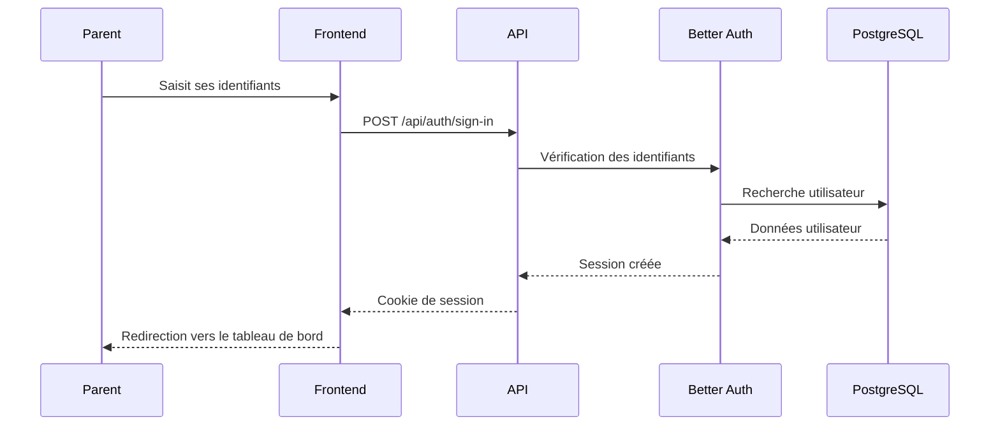
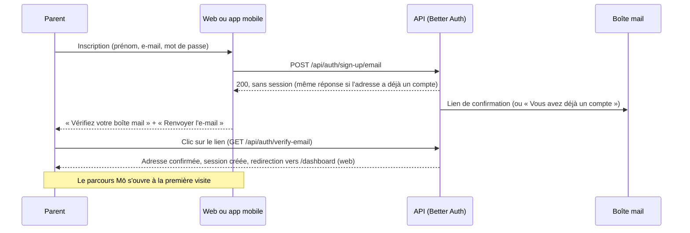

# Authentification

Système d'authentification de Tokō basé sur **Better Auth**. Ce document explique les méthodes de connexion, la gestion des sessions et la protection des routes.

## Méthodes de connexion

Tokō propose deux méthodes d'authentification :

- **Email / mot de passe** — Inscription et connexion classiques
- **Google OAuth** — Connexion via compte Google (optionnel, nécessite la configuration des clés)

Un compte démo est disponible : `demo@toko.app` / `demo1234`.

## Flux de connexion

Le parent saisit ses identifiants sur la page de connexion. Better Auth vérifie les données en base et crée une session. Un cookie sécurisé est renvoyé au navigateur.

## Vérification de l'adresse e-mail

Un compte e-mail / mot de passe ne s'ouvre qu'une fois l'adresse confirmée (`emailAndPassword.requireEmailVerification` dans `apps/api/src/lib/auth.ts`).

- **Pas d'énumération de comptes.** Avec `requireEmailVerification`, une inscription sur une adresse déjà utilisée répond comme une nouvelle inscription (200, utilisateur fictif, pas de session) au lieu de `422 USER_ALREADY_EXISTS_USE_ANOTHER_EMAIL`. Un seul e-mail part dans les deux cas : `onExistingUserSignUp` envoie un nouveau lien si le compte existant n'est pas confirmé, sinon « Vous avez déjà un compte » (lien vers `/login` seulement). `POST /api/auth/send-verification-email` répond aussi `{ status: true }` que l'adresse existe ou non.
- **Connexion avant confirmation.** `POST /api/auth/sign-in/email` répond `403 EMAIL_NOT_VERIFIED`, et seulement après un mot de passe correct (sinon `401 INVALID_EMAIL_OR_PASSWORD`). Le web et l'app affichent « Votre adresse e-mail n'est pas encore confirmée » avec « Renvoyer l'e-mail ».
- **Lien.** Valable 24 h (`emailVerification.expiresIn`). Il pointe toujours vers le web : `sendVerificationEmail` réécrit le `callbackURL` en `APP_URL/dashboard` (ou `/invite/…` pour une invitation co-parent), même pour une inscription faite dans l'app mobile, dont le `callbackURL` serait un lien profond `toko://`. `autoSignInAfterVerification` connecte le parent sur le web ; dans l'app, il se connecte ensuite avec son mot de passe.
- **Renvoi.** Bouton « Renvoyer l'e-mail » avec une attente de 60 s côté client ; l'API limite `/send-verification-email` à 5 par minute et par IP. Le job de relances (`jobs/email/verification-reminders.ts`) envoie jusqu'à 3 nouveaux liens (J+1, J+3, J+7).
- **Comptes existants.** La migration `0064_grandfather_email_verified.sql` passe `email_verified` à `true` pour tous les comptes présents au déploiement : ils avaient déjà accès, rien ne change pour eux. Seuls les comptes créés ensuite doivent confirmer leur adresse. Les comptes Google sont déjà confirmés (Better Auth reprend `email_verified` de Google). Contrepartie assumée : un compte créé avant le déploiement avec une adresse jamais confirmée passe pour confirmé, y compris pour accepter une invitation co-parent.
- **En développement.** Sans `RESEND_API_KEY`, `EMAIL_OUTBOX_DIR` fait écrire chaque e-mail en JSON dans ce dossier au lieu de l'envoyer (jamais en production). Le harnais `verify` s'en sert (`control-toko mail`).

## Configuration

Les variables d'environnement nécessaires :

| Variable | Rôle | Obligatoire |
|----------|------|-------------|
| `BETTER_AUTH_SECRET` | Clé de chiffrement des sessions (min. 32 caractères) | Oui |
| `BETTER_AUTH_URL` | URL de base de l'API | Oui |
| `GOOGLE_CLIENT_ID` | Identifiant OAuth Google | Non |
| `GOOGLE_CLIENT_SECRET` | Secret OAuth Google | Non |

> **Détail technique** — La clé `BETTER_AUTH_SECRET` doit être générée avec `openssl rand -base64 32`. Ne jamais la commiter dans le code source.

## Sessions

- **Durée** : 30 jours
- **Stockage** : Cookie HTTP sécurisé
- **Cache** : Activé côté serveur (5 minutes) pour éviter les requêtes base à chaque appel
- **Tables** : `session` (tokens actifs) et `account` (providers OAuth)

## Protection des routes

### Côté backend

Le middleware `apps/api/src/middleware/auth.ts` vérifie la session sur chaque route protégée. Il extrait le cookie de session, valide le token via Better Auth et injecte l'utilisateur dans le contexte Hono. Si la session est invalide, une erreur 401 est renvoyée.

### Côté frontend

Le layout `_authenticated.tsx` utilise le hook `beforeLoad` de TanStack Router. Avant chaque navigation vers une route protégée, il appelle `authClient.getSession()`. Si aucune session n'existe, l'utilisateur est redirigé vers `/login`.

## Routes publiques

Les pages suivantes sont accessibles sans authentification :

- `/` — Page d'accueil
- `/login` — Connexion et inscription
- `/mentions-legales` — Mentions légales
- `/confidentialite` — Politique de confidentialité
- `/contact` — Page de contact
