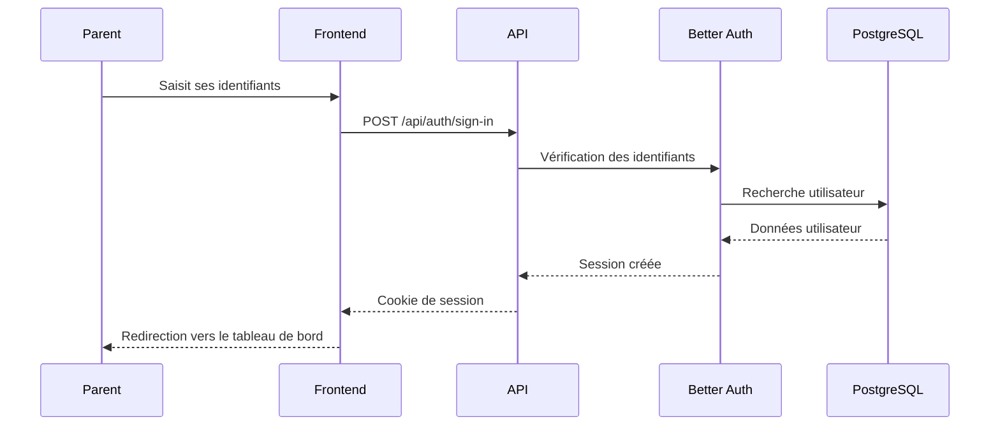
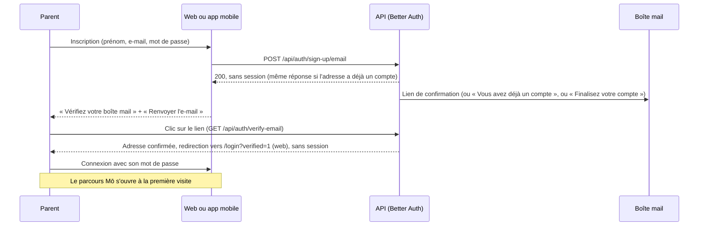

# Authentification

Système d'authentification de Tokō basé sur **Better Auth**. Ce document explique les méthodes de connexion, la gestion des sessions et la protection des routes.

## Méthodes de connexion

Tokō propose deux méthodes d'authentification :

- **Email / mot de passe** — Inscription et connexion classiques
- **Google OAuth** — Connexion via compte Google (optionnel, nécessite la configuration des clés)

Un compte démo est disponible : `demo@toko.app` / `demo1234`.

## Flux de connexion

Le parent saisit ses identifiants sur la page de connexion. Better Auth vérifie les données en base et crée une session. Un cookie sécurisé est renvoyé au navigateur.

## Vérification de l'adresse e-mail

Un compte e-mail / mot de passe ne s'ouvre qu'une fois l'adresse confirmée (`emailAndPassword.requireEmailVerification` dans `apps/api/src/lib/auth.ts`).

- **Pas d'énumération de comptes.** Avec `requireEmailVerification`, une inscription sur une adresse déjà utilisée répond comme une nouvelle inscription (200, utilisateur fictif aux mêmes champs dans le même ordre via `customSyntheticUser`, pas de session) au lieu de `422 USER_ALREADY_EXISTS_USE_ANOTHER_EMAIL`. Un seul e-mail part dans chaque cas (`onExistingUserSignUp`), avec une salutation neutre (« Bonjour, ») : le nom d'un compte non confirmé a été saisi par celui qui l'a créé : « Vous avez déjà un compte » (lien vers `/login` seulement) si le compte est confirmé, « Finalisez votre compte » (lien de réinitialisation) s'il ne l'est pas. `POST /api/auth/send-verification-email` répond `{ status: true }` que l'adresse existe ou non. Les e-mails d'authentification partent en tâche de fond (`sendInBackground`) : la réponse HTTP n'attend jamais Resend, donc son délai ne dit pas si un e-mail est parti.
- **Pas de prise de contrôle par pré-inscription.** Quelqu'un peut inscrire l'adresse d'un autre avec son propre mot de passe. Deux protections :
  - une nouvelle inscription sur ce compte non confirmé n'envoie jamais de lien de vérification, mais un lien de **réinitialisation** du mot de passe (« Finalisez votre compte ») ;
  - **une réinitialisation reprend le compte** à quiconque y était entré : Better Auth remplace le mot de passe et supprime toutes les sessions (`revokeSessionsOnPasswordReset`), puis `onPasswordReset` (`apps/api/src/lib/account-recovery.ts`), dans une seule transaction, supprime d'abord toutes les sessions, puis révoque les clés d'accès agent, supprime les passkeys, les appareils de confiance 2FA, les abonnements push, les invitations co-parent en attente émises par le compte et, si l'adresse n'était pas encore confirmée, la 2FA (inscrite avant toute preuve de la boîte) ; il confirme enfin l'adresse. **Pas de course** : les routes qui créent un identifiant durable (clé agent, abonnement push, invitation co-parent) verrouillent la ligne de leur session `FOR SHARE` dans la même transaction que l'insertion (`apps/api/src/lib/live-session.ts`) ; la suppression des sessions par le reset attend ce verrou, puis révoque ce qui vient d'être créé, et toute création ultérieure trouve sa session disparue et répond 401. L'enregistrement d'une passkey (route Better Auth) est vérifié juste après l'insertion : si la session a disparu, la passkey est supprimée. Sur un compte déjà confirmé, la 2FA reste : c'est elle qui protège le compte quand seule la boîte mail est compromise ;
  - **pas de connexion automatique après la vérification** (`autoSignInAfterVerification: false`). Cliquer le lien prouve qu'on lit la boîte mail, pas qu'on a choisi le mot de passe. Le lien confirme l'adresse et mène à `/login?verified=1` ; le parent se connecte avec son mot de passe, ou le réinitialise, ce qui écarte le tiers. Coût : une connexion de plus après le clic. C'est le choix le plus sûr, car rien ne distingue un compte créé par le titulaire de l'adresse d'un compte créé par un tiers.
- **Connexion avant confirmation.** `POST /api/auth/sign-in/email` répond `403 EMAIL_NOT_VERIFIED`, et seulement après un mot de passe correct (sinon `401 INVALID_EMAIL_OR_PASSWORD`). Le web et l'app affichent « Votre adresse e-mail n'est pas encore confirmée » avec « Renvoyer l'e-mail ».
- **Lien.** Valable 24 h (`emailVerification.expiresIn`). Il pointe toujours vers le web : `sendVerificationEmail` réécrit le `callbackURL` en `APP_URL/login?verified=1` (ou `/invite/…` pour une invitation co-parent), même pour une inscription faite dans l'app mobile, dont le `callbackURL` serait un lien profond `toko://`. Un lien expiré ou invalide mène à `/login?verified=1&error=…` : « Ce lien n'est plus valable… ».
- **Renvoi.** Bouton « Renvoyer l'e-mail » avec une attente de 60 s côté client. En production, Better Auth limite aussi `/send-verification-email` à 5 par minute et par IP (son limiteur est désactivé hors production). Le job de relances (`jobs/email/verification-reminders.ts`) envoie jusqu'à 3 nouveaux liens (J+1, J+3, J+7).
- **Comptes existants.** La migration `0064_grandfather_email_verified.sql` passe `email_verified` à `true` pour les comptes créés avant le 2026-10-25 19:00 (borne fixe, antérieure au merge), au démarrage de l'API qui déploie ce changement. Ils avaient déjà accès, rien ne change pour eux. La borne de date protège d'un rejeu manuel. Un compte créé entre la borne et le déploiement doit confirmer son adresse (il a reçu l'e-mail à l'inscription). Les comptes Google sont déjà confirmés (Better Auth reprend `email_verified` de Google). Contrepartie assumée : un compte ancien jamais confirmé passe pour confirmé, y compris pour accepter une invitation co-parent.
- **En développement.** Sans `RESEND_API_KEY`, `EMAIL_OUTBOX_DIR` fait écrire chaque e-mail en JSON dans ce dossier au lieu de l'envoyer. En production, la variable est ignorée (avertissement au démarrage). Le harnais `verify` s'en sert (`control-toko mail`) ; son serveur Vite refuse de servir `.verify-run/`.

## Configuration

Les variables d'environnement nécessaires :

| Variable | Rôle | Obligatoire |
|----------|------|-------------|
| `BETTER_AUTH_SECRET` | Clé de chiffrement des sessions (min. 32 caractères) | Oui |
| `BETTER_AUTH_URL` | URL de base de l'API | Oui |
| `GOOGLE_CLIENT_ID` | Identifiant OAuth Google | Non |
| `GOOGLE_CLIENT_SECRET` | Secret OAuth Google | Non |

> **Détail technique** — La clé `BETTER_AUTH_SECRET` doit être générée avec `openssl rand -base64 32`. Ne jamais la commiter dans le code source.

## Sessions

- **Durée** : 30 jours
- **Stockage** : Cookie HTTP sécurisé
- **Pas de cache de cookie** : chaque requête authentifiée relit la session en base (2 lectures indexées), pour qu'une session révoquée (réinitialisation, blocage, déconnexion) soit refusée dès la requête suivante
- **Tables** : `session` (tokens actifs) et `account` (providers OAuth)

## Protection des routes

### Côté backend

Le middleware `apps/api/src/middleware/auth.ts` vérifie la session sur chaque route protégée. Il extrait le cookie de session, valide le token via Better Auth et injecte l'utilisateur dans le contexte Hono. Si la session est invalide, une erreur 401 est renvoyée.

### Côté frontend

Le layout `_authenticated.tsx` utilise le hook `beforeLoad` de TanStack Router. Avant chaque navigation vers une route protégée, il appelle `authClient.getSession()`. Si aucune session n'existe, l'utilisateur est redirigé vers `/login`.

## Routes publiques

Les pages suivantes sont accessibles sans authentification :

- `/` — Page d'accueil
- `/login` — Connexion et inscription
- `/mentions-legales` — Mentions légales
- `/confidentialite` — Politique de confidentialité
- `/contact` — Page de contact
